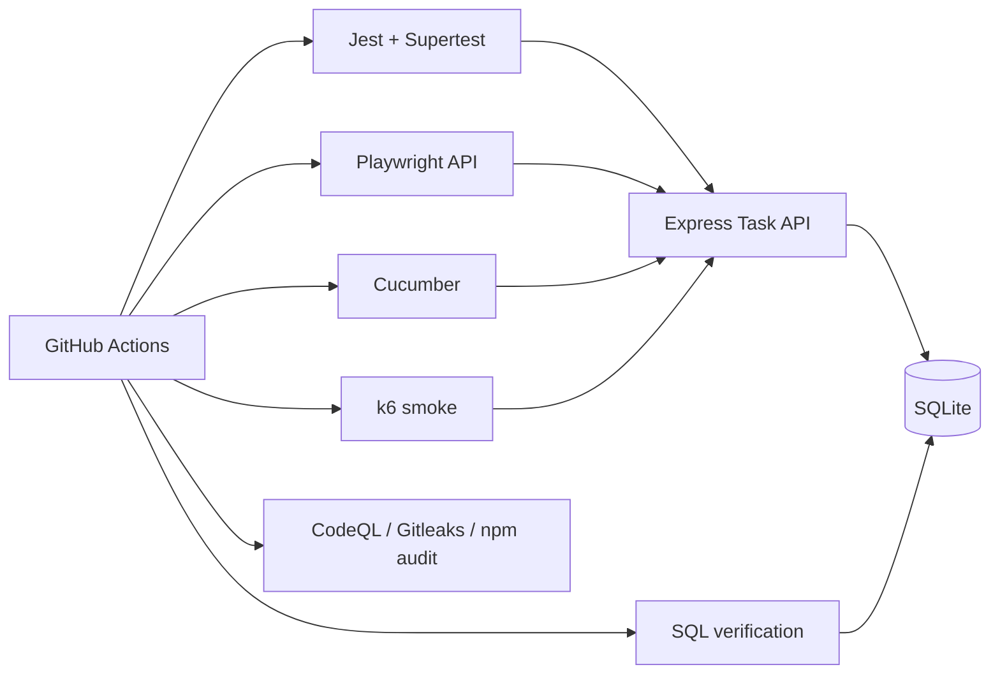

# TestingPro — API Quality Engineering Framework

[](https://github.com/Manvithagopireddy/TestingPro/actions/workflows/api-tests.yml)
[](https://github.com/Manvithagopireddy/TestingPro/actions/workflows/advanced-quality.yml)
[](https://github.com/Manvithagopireddy/TestingPro/actions/workflows/security-audit.yml)

**A reproducible API testing portfolio project** built around a synthetic Task Manager REST API. It demonstrates automated functional, boundary, authentication, database, contract and performance checks, plus CI security scanning.

> **Local demonstration only.** The demo has shared test credentials and is not a production authentication service. Do not expose it to the public internet or store real user data.

## At a glance

| Area | Implementation |
|---|---|
| API | Node.js, Express, JWT, SQLite using sql.js |
| Unit/integration tests | Jest, Supertest |
| API regression tests | Playwright APIRequestContext |
| Behavior-driven testing | Cucumber/Gherkin |
| API specification | [OpenAPI 3.0](docs/openapi.yaml) |
| Database verification | Direct SQL validation |
| Performance smoke testing | k6 (2 virtual users, 10 seconds) |
| Code quality | ESLint and Prettier |
| Security | npm audit, CodeQL, Gitleaks Git-history scanning |
| Delivery | GitHub Actions, local Docker demonstration |

The [Postman collection](tests/TaskManagerAPI.postman_collection.json) is retained for manual import and review. **Its former Newman CLI runner was removed** because the audit identified vulnerabilities in the Newman and HTML reporter dependency trees. The Playwright regression suite covers critical API interactions, but does not imply exact one-for-one replacement of every historical Postman assertion.

## Verified historical evidence

The following results were measured on **25 November 2026** and relate to the specified workflow runs, not automatically to the latest commit.

| Test | Result | Evidence |
|---|---|---|
| Jest | 50/50 passed across 5 suites | [Original CI run](https://github.com/Manvithagopireddy/TestingPro/actions/runs/45643148215) |
| Jest coverage | Statements 93.78%, branches 87.87%, functions 100%, lines 93.78% | [Original CI run](https://github.com/Manvithagopireddy/TestingPro/actions/runs/45643148215) |
| Playwright | 4/4 API tests passed before regression-suite expansion | [Advanced quality run](https://github.com/Manvithagopireddy/TestingPro/actions/runs/45643944497) |
| k6 smoke | 160/160 checks, p95 1.56 ms, 0 failed requests (local smoke only) | [Advanced quality run](https://github.com/Manvithagopireddy/TestingPro/actions/runs/45643944497) |
| Newman (historical, no longer CI default) | 26 requests, 107 assertions, 0 failures | [Original CI run](https://github.com/Manvithagopireddy/TestingPro/actions/runs/45643148215) |
| Dependency audit (before remediation) | 2 runtime and 30 total advisories | [Previous audit](https://github.com/Manvithagopireddy/TestingPro/actions/runs/45643944511) |

**For current pass/fail results, always check [GitHub Actions](https://github.com/Manvithagopireddy/TestingPro/actions).** Dependencies and test counts may change after security remediation.

## Run locally

Prerequisites: Node.js 22+, npm and Git.

```bash
git clone https://github.com/Manvithagopireddy/TestingPro.git
cd TestingPro
npm ci
npm run seed
npm start
```

The server binds to **127.0.0.1:3000** by default. In another terminal, run:

```bash
npm run test:coverage          # Jest + coverage thresholds
npm run test:cucumber          # Gherkin behavioral regression
npm run test:playwright        # API-only tests; no browser install needed
npm run validate:db            # Direct SQLite data verification
npm run lint                   # ESLint
npm run format:check           # Prettier config format gate
npm run security:audit         # Full dependency tree
npm run security:runtime       # Runtime-only dependency tree
```

Example health check: `curl http://127.0.0.1:3000/health`.

### API overview

| Method | Path | Description |
|---|---|---|
| GET | `/health` | Health endpoint |
| POST | `/auth/login` | Obtain demo JWT |
| GET | `/tasks` | List tasks |
| POST | `/tasks` | Create task |
| GET | `/tasks/{id}` | Retrieve one task |
| PUT | `/tasks/{id}` | Update task |
| DELETE | `/tasks/{id}` | Delete task |

All task endpoints require a JWT obtained using the synthetic account `testuser` / `password123`. See [OpenAPI](docs/openapi.yaml) for request and response schemas.

## Test architecture



## Local Docker demonstration

```bash
docker compose up --build
```

The Compose file maps only `127.0.0.1:3000` on your machine. This is **not** a recommended public deployment configuration.

## Engineering documentation

- [Case study](docs/CASE_STUDY.md): decisions, architecture, outcomes and limitations
- [CI evidence](docs/CI_EVIDENCE.md): verified historical results and links
- [Quality guide](docs/QUALITY_GUIDE.md): running suites and inspecting reports
- [Security audit](docs/SECURITY_AUDIT.md): original dependency findings and remediation history
- [Security policy](SECURITY.md): reporting concerns

## Security and maintenance

The project intentionally maintains a strict, failing-on-findings dependency audit. **A passing test suite does not imply the absence of security advisories.** Check [security issue #9](https://github.com/Manvithagopireddy/TestingPro/issues/9) and the [latest audit workflow](https://github.com/Manvithagopireddy/TestingPro/actions/workflows/security-audit.yml) for the verified remediation status.

## Author

**Gopireddy Manvitha** · [GitHub profile](https://github.com/Manvithagopireddy) · [LinkedIn](https://www.linkedin.com/in/gopireddymanvitha/)

This repository is intended as evidence of test-design and engineering practice, not as a claim of production readiness.
