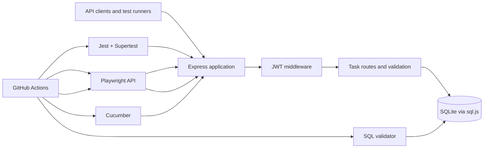

# TestingPro — Engineering case study

**Type:** personal QA/SDET portfolio case study  
**Technology:** Node.js, Express, SQLite (sql.js), JWT, Jest, Supertest, Playwright, Cucumber, GitHub Actions

## Engineering problem

An HTTP API can appear functional while accepting malformed inputs, leaking internal errors, or regressing between releases. This project pairs a small Task Manager API with independent test strategies so that expected behavior is reproducible.

## Architecture



## Implemented quality controls

- Task validation rejects blank titles, non-string descriptions, unexpected statuses, and invalid identifiers.
- Parameterized database access helps prevent SQL injection.
- JWT verification explicitly restricts verification to HS256.
- Request payloads have size limits, internal errors are not returned to clients, and the demo server binds to localhost by default.
- Jest coverage gates fail below 80% of statements, functions and lines, or below 75% of branches.
- Separate API smoke and load-test suites exercise the service without a browser.

## Verified historical CI evidence

[GitHub Actions run 45643148215](https://github.com/Manvithagopireddy/TestingPro/actions/runs/45643148215) from **25 November 2026** reported:

| Metric | Result |
|---|---:|
| Jest test suites | 5 passed |
| Jest test cases | 50 passed |
| Statement coverage | 93.78% |
| Branch coverage | 87.87% |
| Function coverage | 100% |
| Line coverage | 93.78% |
| Newman requests | 26; 0 failures |
| Newman assertions | 107; 0 failures |

These measurements describe that CI revision, **not** future branches or the extended-quality changes until they pass. Download the actual HTML reports and coverage files from the **test-reports** artifact for that run.

## Historical dependency security findings

The original successful CI installation logged **30 npm advisories**, which have now been addressed in the [remediation workflow](https://github.com/Manvithagopireddy/TestingPro/actions/runs/45646931725): **0 runtime and 0 full-tree advisories**. Historical Newman results remain documented, but the vulnerable runner has been removed.

## Running locally

```bash
git clone https://github.com/Manvithagopireddy/TestingPro.git
cd TestingPro
npm ci
npm run seed
npm start
# In a second terminal:
npm run test:coverage
```

Advanced API tests and formatting can be run after installing the pinned optional CI tools described in [QUALITY_GUIDE.md](QUALITY_GUIDE.md). For containers: `docker compose up --build` binds only to your computer's localhost.

## Scope and limitations

This is a **synthetic local demonstration**, not a deployable authentication product. The sample account is intentionally hardcoded and has no tenant isolation. Load testing is limited to local smoke workloads. Do not expose the API to the public internet, or store real data in it. No performance or security certification is claimed.
